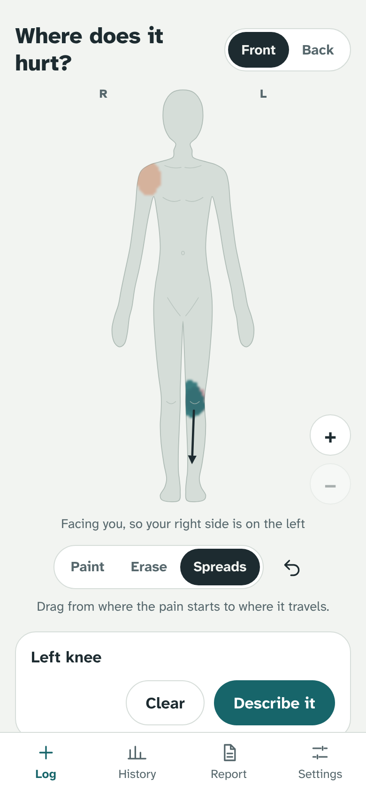
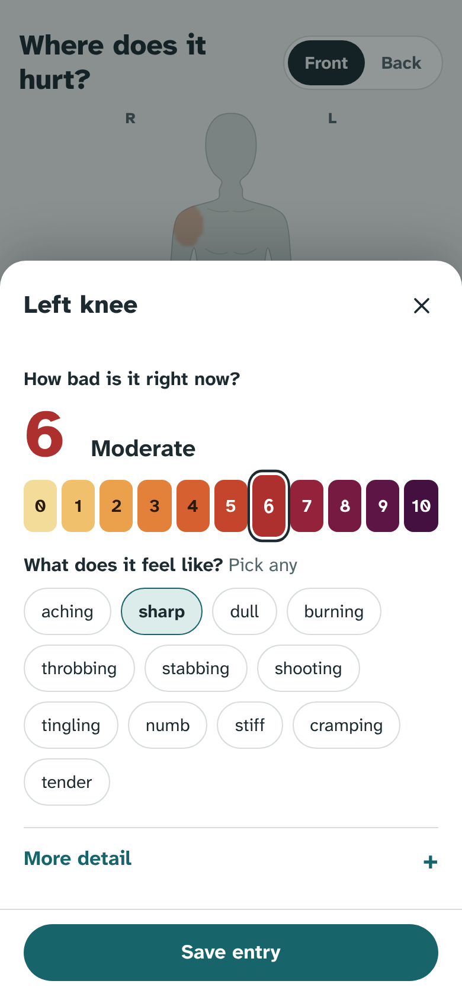
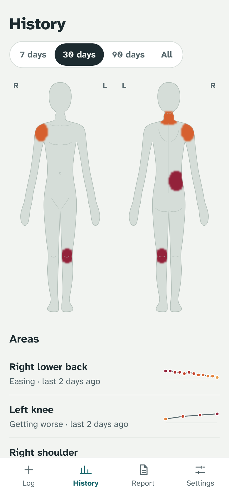
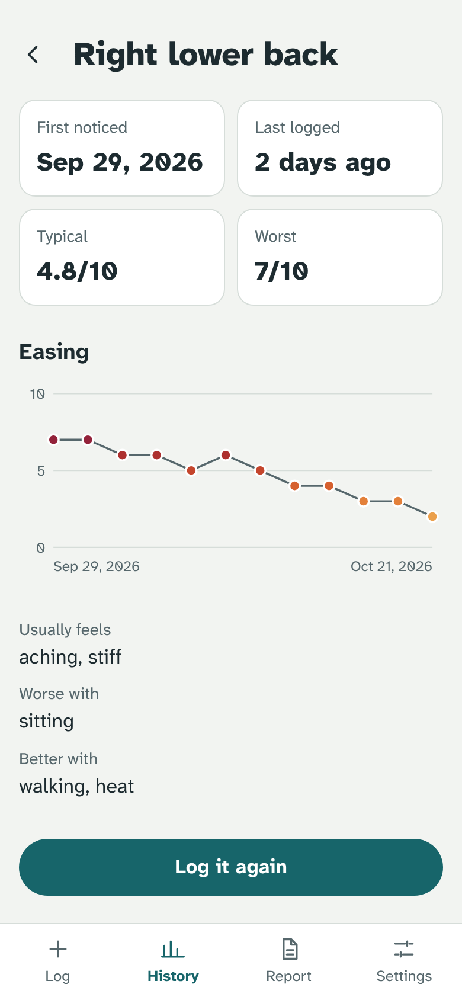

# Hurtly

**Paint where it hurts. See how it changes. Show your doctor.**

Hurtly is a free, private pain diary that runs in your browser and installs on your phone. You paint where it hurts on a body figure, say what it feels like, and over days and weeks it builds a clear history you can hand to a doctor or physio.

**Try it:** [body-trace.vercel.app](https://body-trace.vercel.app)

<p>
  
  
  
  
</p>

## What it does

- **Paint it.** Paint where it hurts with your finger, draw arrows where it spreads, and pinch to zoom for small areas. Hurtly works out which areas you mean.
- **Describe it.** Pick a 0–10 intensity and what it feels like. Pattern, triggers, what helps and what it gets in the way of are optional.
- **Watch it change.** Each area gets a timeline: when it started, typical and worst intensity, and whether it's getting worse, easing or holding steady.
- **Share it.** A one-page report to print or save as PDF, plus a spreadsheet export.

Logging a known area again takes two taps, and "No pain today" check-ins keep good days in the record, not just bad ones.

## Private by design

- **Your entries never leave your device.** They're stored in your browser. There's no account, no server and no tracking. Export a backup from Settings to move them.
- **AI is optional, and you choose where it runs:**
  - **On this device:** the browser's built-in model (desktop Chrome 148 and later). Free and private; nothing you type leaves the device.
  - **Gemini with your own key:** works in any browser. Your key stays in your browser and requests go straight to Google.
  - **Off:** built-in follow-up questions instead.

With AI you can describe pain in your own words ("burning in my lower right back, about a 6, worse when I sit") and the form fills itself in for you to check. It also asks a useful follow-up question and writes a plain-English summary for your report. It never diagnoses or suggests treatment.

Read more in [PRIVACY.md](PRIVACY.md).

## Not medical advice

Hurtly is a personal record. It doesn't diagnose or give medical advice. If pain is sudden or severe, or comes with other worrying symptoms, contact a medical professional or emergency services.

## Development

```bash
npm install
npm run dev        # http://localhost:5173
npm test           # unit tests (Vitest)
npm run build      # type-check and build the installable app into dist/
```

React 19, TypeScript, Vite, Dexie (IndexedDB) and vite-plugin-pwa. The build is a static site that runs from any static host.

```
src/
  data/regions.ts            body outline, landmarks and area zones (left/right handled per view)
  data/questions.ts          offline follow-up questions
  lib/mask.ts                painted areas as a grid over the figure; areas are worked out from the paint
  lib/ai.ts                  prompts, and checks on everything the AI returns
  lib/ondevice.ts            the browser's built-in model
  lib/gemini.ts              bring-your-own-key Gemini client
  lib/stats.ts               per-area summaries, trends, daily series
  lib/safety.ts              offline emergency-warning rules
  components/BodyCanvas.tsx  painting, arrows, zoom, heat maps
  screens/log/               the Log screen, its sheets, and the paint editor
  screens/                   History, Area, Report, Settings
```

Contributions are welcome. See [CONTRIBUTING.md](CONTRIBUTING.md).

## License

Copyright (C) 2025–2026 learnermaker and contributors.

Hurtly is free software: you can redistribute it and/or modify it under the terms of the [GNU Affero General Public License](LICENSE) as published by the Free Software Foundation, either version 3 of the License, or (at your option) any later version. If you run a modified version for others, for example as a website, you must offer them its source code.
